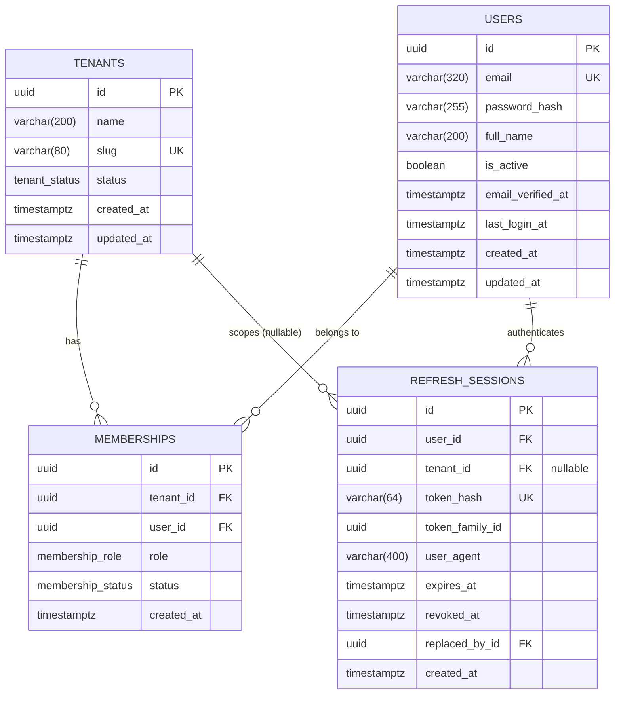

# ZAIN AGRI — Database Design

Status: Sprint 02
Last updated: 2026-10-31
Engine: PostgreSQL 17.5 (local dev cluster, port 5433)

---

## 1. Principles

| # | Principle | Consequence |
|---|---|---|
| 1 | PostgreSQL is the source of truth | Constraints live in the database, not only in Python |
| 2 | Every tenant-owned row carries `tenant_id` | Isolation is a data property, not a query convention |
| 3 | Tenant isolation is enforced twice | Application filter **and** Row Level Security |
| 4 | The application never runs as the schema owner | RLS cannot be bypassed by the code path that serves requests |
| 5 | Schema changes only through Alembic | No manual DDL in any environment |
| 6 | UTC everywhere | `TIMESTAMPTZ`, written as UTC, rendered in Africa/Cairo |
| 7 | No speculative tables | Only what the current sprint can justify exists today |

## 2. Roles and connections

Two roles, two URLs, on purpose.

| Role | Used by | Attributes | Purpose |
|---|---|---|---|
| `zain` | Alembic, `scripts/db-init.ps1` | superuser, owns `public` | migrations and bootstrap only |
| `zain_app` | FastAPI runtime, tests | `NOSUPERUSER NOBYPASSRLS NOCREATEDB NOCREATEROLE` | all application queries |

```
DATABASE_URL           → zain_app   (app + tests)
MIGRATION_DATABASE_URL → zain       (Alembic only)
```

If the runtime role were a superuser, or owned the tables it queries, PostgreSQL
would skip every policy and the isolation tests would be theatre. That is why the
first isolation test asserts `rolsuper = false` and `rolbypassrls = false`.

**Grants.** `infrastructure/db/grants.sql` runs after migrations and grants
`SELECT, INSERT, UPDATE, DELETE` on all tables plus `ALTER DEFAULT PRIVILEGES`, so
tables created by future migrations are covered automatically. It also grants
`EXECUTE` on `app_user_tenants(uuid)` — the only function the runtime role may
call. Grants are kept out of Alembic because role names differ per environment.

## 3. Schema



Four tables. Nothing else is justified yet.

### 3.1 `tenants`

| Column | Type | Constraints |
|---|---|---|
| `id` | `uuid` | PK `pk_tenants`, generated in the application |
| `name` | `varchar(200)` | NOT NULL |
| `slug` | `varchar(80)` | NOT NULL, `uq_tenants_slug` |
| `status` | `tenant_status` | NOT NULL, default `'active'` |
| `created_at` | `timestamptz` | NOT NULL, default `now()` |
| `updated_at` | `timestamptz` | NOT NULL, default `now()` |

`slug` is the human-readable identifier (subdomain, support lookup). It is
unique globally, so it is also a first-come reservation across the platform.

`status` is a native enum: `active`, `suspended`. Suspension is a business state,
not a delete. There is no soft-delete column — an actual deletion path is a
Sprint 02+ decision (see `OPEN_QUESTIONS.md`).

### 3.2 `users`

| Column | Type | Constraints |
|---|---|---|
| `id` | `uuid` | PK `pk_users` |
| `email` | `varchar(320)` | NOT NULL, `uq_users_email` |
| `password_hash` | `varchar(255)` | NOT NULL |
| `full_name` | `varchar(200)` | NOT NULL |
| `is_active` | `boolean` | NOT NULL, default `true` |
| `email_verified_at` | `timestamptz` | NULL until verified |
| `last_login_at` | `timestamptz` | NULL |
| `created_at` | `timestamptz` | NOT NULL, default `now()` |
| `updated_at` | `timestamptz` | NOT NULL, default `now()` |

Index `ix_users_email_lower` is unique on `lower(email)`, so
`Owner@Store.com` and `owner@store.com` cannot both exist. The application
normalises to lowercase before insert; the functional index is the backstop.

`password_hash` stores an Argon2id hash (Sprint 02). Plaintext passwords are
never written, logged, or accepted by any column here.

`email_verified_at` is set only by a future verification flow. The API enforces
verification only when `REQUIRE_EMAIL_VERIFICATION=true`; no transport exists
yet, so it defaults to `false`.

**`users` is deliberately not tenant-scoped.** A person can be a member of more
than one tenant, so a `tenant_id` on this table would be wrong by construction.
Access is mediated by `memberships`, and the API must never expose a user record
outside a membership check. This is the least settled part of the model and is
tracked in `OPEN_QUESTIONS.md`.

### 3.3 `memberships`

| Column | Type | Constraints |
|---|---|---|
| `id` | `uuid` | PK `pk_memberships` |
| `tenant_id` | `uuid` | NOT NULL, FK → `tenants.id` ON DELETE CASCADE |
| `user_id` | `uuid` | NOT NULL, FK → `users.id` ON DELETE CASCADE |
| `role` | `membership_role` | NOT NULL, default `'cashier'` |
| `status` | `membership_status` | NOT NULL, default `'active'` |
| `created_at` | `timestamptz` | NOT NULL, default `now()` |

- `uq_memberships_tenant_user` — one membership per (tenant, user).
- `ix_memberships_tenant_id`, `ix_memberships_user_id` — both directions are queried
  (list a tenant's staff; resolve a user's tenants).
- `ix_memberships_user_status` — the login path filters by `(user_id, status)`.

`membership_role` is a native enum: `owner`, `manager`, `cashier`,
`inventory_manager`. Sprint 02 rebuilt it from the provisional
`owner/admin/member` vocabulary; migration `0002_auth` maps `admin → manager` and
`member → cashier` explicitly.

`membership_status` is a native enum: `active`, `invited`, `suspended`. Only
`active` memberships may enter a workspace. The default is `active` because
Sprint 02 has no invitation flow; `invited` exists for the future one.

The cascade means deleting a tenant or a user removes its memberships. It does
**not** delete the user's other memberships, which is the intended behaviour.

### 3.4 `refresh_sessions`

One row per live (or rotated-away) refresh token.

| Column | Type | Constraints |
|---|---|---|
| `id` | `uuid` | PK `pk_refresh_sessions`; also the JWT `sid` |
| `user_id` | `uuid` | NOT NULL, FK → `users.id` ON DELETE CASCADE |
| `tenant_id` | `uuid` | NULL, FK → `tenants.id` ON DELETE CASCADE |
| `token_hash` | `varchar(64)` | NOT NULL, `uq_refresh_sessions_token_hash` |
| `token_family_id` | `uuid` | NOT NULL, indexed |
| `user_agent` | `varchar(400)` | NULL |
| `expires_at` | `timestamptz` | NOT NULL |
| `revoked_at` | `timestamptz` | NULL |
| `replaced_by_id` | `uuid` | NULL, FK → `refresh_sessions.id` ON DELETE SET NULL |
| `created_at` | `timestamptz` | NOT NULL, default `now()` |

- `token_hash` is the SHA-256 hex digest of the opaque token. The raw token is
  never stored anywhere.
- `tenant_id` is nullable: a session exists between registration and tenant
  selection. Creating a workspace rotates the session and binds it.
- `token_family_id` groups a login and all its rotations. Replaying a revoked
  token revokes every still-active member of the family.
- `replaced_by_id` records the rotation chain for forensics.
- Indexes: `ix_refresh_sessions_user_id`, `ix_refresh_sessions_tenant_id`,
  `ix_refresh_sessions_user_expires`, `ix_refresh_sessions_family`.
- Deleting a tenant cascades its sessions away, which invalidates every access
  token minted for that workspace (`401` on the next request).
- **No RLS on this table.** Rotation happens before a tenant is known; every
  query filters by `user_id`, and the row is never returned by the API. This is
  documented in `docs/security/TENANT_ISOLATION.md` §3.2.

## 4. Row Level Security

Both tenant-owned tables (`tenants`, `memberships`) have RLS enabled.

```sql
-- tenants
USING      (id = nullif(current_setting('app.tenant_id', true), '')::uuid)
WITH CHECK (id = nullif(current_setting('app.tenant_id', true), '')::uuid)

-- memberships
USING      (tenant_id = nullif(current_setting('app.tenant_id', true), '')::uuid)
WITH CHECK (tenant_id = nullif(current_setting('app.tenant_id', true), '')::uuid)
```

Three properties matter more than the SQL:

1. **`current_setting(..., true)` returns NULL when unset.** Comparing anything to
   NULL is unknown, so the policy rejects every row. Unbound queries return zero
   rows — never all rows.
2. **`nullif(..., '')` handles the reset case.** `set_config(..., '')` is how the
   context is cleared; a plain cast of `''` to `uuid` would raise instead.
3. **`WITH CHECK` covers writes.** A tenant cannot insert a membership addressed
   to a different tenant; the database raises
   `new row violates row-level security policy`.

`tenants` uses `id = ...` because the tenant's own row is its tenancy scope. A
tenant can therefore read and update only itself, which is what the API needs.

`users` has no policy: it is not tenant-owned. See §3.2 and `OPEN_QUESTIONS.md`.

### 4.1 Cross-tenant lookup function

Login must resolve "which workspaces may this user enter?" before any tenant
context exists. Instead of weakening the policies, `0003_user_tenants` adds:

```sql
app_user_tenants(p_user_id uuid)
  RETURNS TABLE (tenant_id, tenant_name, tenant_slug,
                 tenant_status, role, membership_status)
  LANGUAGE sql STABLE SECURITY DEFINER
  SET search_path = public, pg_temp
```

`REVOKE ALL … FROM PUBLIC` is executed in the migration; `grants.sql` grants
`EXECUTE` to the runtime role only. The function is read-only, returns only the
given user's rows, and cannot write around `WITH CHECK`.

## 5. Tenant context protocol

```python
async def set_tenant_context(session, tenant_id):
    await session.execute(
        text("SELECT set_config('app.tenant_id', :tid, true)"), {"tid": str(tenant_id)}
    )
```

- `set_config(..., true)` is **transaction-local**. It is discarded at commit or
  rollback, so a pooled connection cannot carry one tenant's identity into the
  next request. A session-level SQLAlchemy `after_begin` listener re-applies the
  binding for later transactions on the same bound session.
- The value is bound as a parameter. `SET LOCAL app.tenant_id = ...` cannot take
  bind parameters and would require string interpolation — not acceptable on a
  security boundary.
- The tenant id must come from the authenticated server-side identity. A
  `tenant_id` in a request body, query string or header is ignored by design.
- Every request that touches tenant data must set the context **inside its
  transaction**, before the first query.

Failing to set the context is fail-closed: the request sees nothing, and it
breaks loudly in development rather than leaking silently.

## 6. Migrations

| Rule | Detail |
|---|---|
| Tool | Alembic (`apps/api/alembic`) |
| URL | `MIGRATION_DATABASE_URL`, resolved in `alembic/env.py` |
| Naming | `NNNN_slug`, explicit revision ids (`0001_identity`) |
| DDL inside a migration | Always via `op.*`, plus `op.execute` for policies |
| Enum creation | Explicit `postgresql.ENUM(..., create_type=False)` + `.create(bind)` |
| Downgrades | Written, not stubbed — including dropping policies |

The first migration is `0001_identity`: enums, three tables, indexes, RLS
policies. Sprint 02 adds:

| Revision | Contents |
|---|---|
| `0002_auth` | `users.email_verified_at`; `memberships.status` + `ix_memberships_user_status`; rebuild of `membership_role` with data mapping; `refresh_sessions` table and indexes |
| `0003_user_tenants` | `SECURITY DEFINER` function `app_user_tenants(uuid)` + `REVOKE ALL … FROM PUBLIC` |

All three are applied to both `zain_agri` and `zain_agri_test`. Downgrades are
written, including dropping the function and reversing the enum mapping.

`alembic/env.py` imports every model module so `Base.metadata` is populated. Any
new model module must be imported there before `--autogenerate` will see it.

## 7. Connection management

| Setting | Value | Note |
|---|---|---|
| Driver | `psycopg` 3 | async for the app, sync for Alembic |
| Pool | `pool_size=5`, `max_overflow=5` | per process |
| `pool_pre_ping` | on | survives a restarted cluster |
| `pool_recycle` | 1800 s | avoids stale server-side connections |
| Isolation | PostgreSQL default (READ COMMITTED) | sufficient for current writes |
| Session | `expire_on_commit=False`, `autoflush=False` | explicit, predictable |

The engine is created lazily through `lru_cache`, so importing `app.main` opens
no sockets. `dispose_engine()` runs on application shutdown and clears the caches.

Test fixture rebuilds the schema per session: drop `public`, recreate, migrate,
apply grants. Tests therefore run against the real migration, not
`create_all()` — a schema drift between models and migrations cannot hide.

## 8. Test database

`zain_agri_test` is recreated per test session (schema only, database kept).
Credentials match the app role, so isolation tests run under exactly the same
privileges as production requests.

## 9. Deliberately absent

Not forgotten — excluded because nothing in Sprint 01 justifies the shape:

- Products, categories, units, batches, stock movements.
- Sales, invoices, payments, cashbox.
- Customers, suppliers, branches.
- Audit log, `created_by` columns.
- Soft deletes, `deleted_at`.
- Password reset tokens, MFA secrets, email verification tokens.
- Partitioning, materialised views, read replicas.

## 10. Known limitations

| Limitation | Impact | Plan |
|---|---|---|
| `updated_at` is set by the ORM (`onupdate`), not a trigger | Raw SQL updates leave it stale | Add a `moddatetime`/trigger migration when admin tooling appears |
| `memberships` has no `updated_at` | A role change is not timestamped | Add with the audit log in Sprint 03 |
| No audit trail | Mutations are unattributable | Audit table alongside sales/finance |
| `users` is not RLS-protected | Requires application-level discipline | Every endpoint resolves a membership first; revisit with a projection function |
| `refresh_sessions` is not RLS-protected | Requires every query to filter by `user_id` | Single service module owns access; row is never serialised |
| Expired refresh sessions are not deleted | Table grows with every login/rotation | Scheduled cleanup job (Sprint 03 operational task) |
| Case-insensitive email relies on app normalisation + functional index | Two indexes on the same column | Acceptable; simplifies to `citext` or a normalised column later if needed |
| `app_user_tenants` accepts any user id from the runtime role | SQL injection could enumerate memberships | Parameter binding throughout; read-only function; `EXECUTE` restricted |
