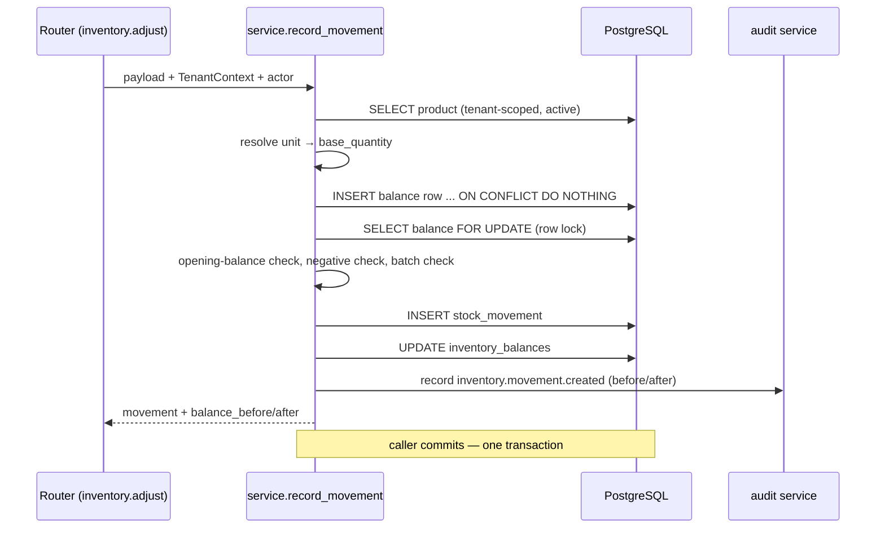

# ZAIN AGRI — Inventory Ledger

Status: Sprint 03
Last updated: 2026-11-01
Code: `apps/api/app/modules/inventory/service.py`

> **Invariant.** Stock is never a mutable number. It is the sum of an
> append-only ledger, and every balance row equals that sum.

This document explains how the invariant survives concurrency, mistakes and
future modules.

---

## 1. Two tables, one writer

```
stock_movements  ──(append only)──►  inventory_balances
   source of truth                     projection
```

- `stock_movements` is append-only. There is no update or delete path in the API.
- `inventory_balances` is a projection so listing stock never sums the ledger.
- Only `app/modules/inventory/service.py` writes balances. Future purchasing and
  sales modules must call `record_movement`, not touch the table.

Balances are not "cached": they are part of the same transaction. If the
movement insert fails, the balance update rolls back with it.

## 2. The write path



Ordered deliberately:

1. **Resolve the product first.** Archived or foreign products fail before any
   write.
2. **Ensure the balance row exists.** `INSERT … ON CONFLICT (tenant_id,
   product_id) DO NOTHING` avoids a race where two first movements both try to
   create the row.
3. **Lock it.** `SELECT … FOR UPDATE` serialises every movement for that
   product. The lock is also the mutex for the opening-balance check and for the
   batch-level sum, so neither can observe a half-applied change.
4. **Append, then project.** The ledger row is the record; the balance is derived
   from it.
5. **Audit inside the same transaction.** `audit.record` only flushes; a failure
   rolls the business change back.

## 3. Conversion at the boundary

The only quantity the ledger trusts is `base_quantity`.

```
base_quantity = ± quantity × factor(unit → base unit)
```

- `factor` comes from `product_unit_conversions` for that product, or is `1` when
  `unit_id` is already the base unit.
- If no conversion exists, the request is rejected (422). Nothing is inferred.
- `quantity` stays positive and in the unit the operator typed, so the ledger
  explains what was entered *and* what it meant.

## 4. Rules

| Invariant | Where enforced |
|---|---|
| No negative product balance | Service check under the row lock + `CHECK (quantity >= 0)` on the projection |
| No negative batch balance | Sum of the batch's movements, under the same lock |
| One opening balance per product | Existence check under the same lock |
| Batch required iff `tracks_batches` | Service check on both directions |
| Movement rows immutable | `app_block_mutation()` trigger + `REVOKE UPDATE, DELETE, TRUNCATE` |
| Balanced ledger | Every mutation writes ledger and projection in one transaction |

### 4.1 Why the lock is enough

Two concurrent `adjustment_out` calls for the same product both need the balance
row lock. The second waits, then re-reads the updated quantity and is rejected if
it would oversell. A test (`test_concurrent_adjustments_cannot_oversell`) issues
two `8`-unit debits against a balance of `10` and asserts exactly one `201` and
one `409`.

Balance rows are per `(tenant, product)`, so different products never serialise
against each other.

### 4.2 Immutability at the database level

```sql
CREATE FUNCTION app_block_mutation() RETURNS trigger
LANGUAGE plpgsql AS $$
BEGIN
    RAISE EXCEPTION 'append-only table: % may not be modified', TG_TABLE_NAME;
END $$;

CREATE TRIGGER stock_movements_append_only
BEFORE UPDATE OR DELETE ON stock_movements
FOR EACH ROW EXECUTE FUNCTION app_block_mutation();
```

The same function guards `audit_logs`. `grants.sql` additionally revokes
`UPDATE, DELETE, TRUNCATE` on both tables from the runtime role, so a future
service that forgets the rule still cannot rewrite history. Migrations (owner
role) can still drop the trigger — that is a deliberate, reviewable act.

## 5. Reconciliation

```python
async def reconcile(session, *, tenant_id, product_id) -> tuple[Decimal, Decimal]:
    ledger = SUM(stock_movements.base_quantity)   # per product
    projection = inventory_balances.quantity      # one row
```

A mismatch is a bug, never a correction path. There is no "fix the balance"
endpoint; a wrong balance is fixed by finding the missed write. The function is
used by `tests/test_inventory.py::test_ledger_and_projection_reconcile`.

Production would run this as a periodic integrity check across all balances and
alert on any difference. Not implemented in Sprint 03.

## 6. What future modules must do

| Module | Rule |
|---|---|
| Purchasing | Record a purchase as `purchase` movements (one per line), inside the receipt transaction |
| Sales | Record `sale` movements; never write balances directly |
| Returns | Record `customer_return` / `supplier_return`; allocate to batches explicitly |
| Transfers | Record `transfer_out` + `transfer_in`; both lines in one transaction |
| Valuation | Read `unit_cost`; no costing method exists yet |

Every one of them inherits the row lock, the negative-stock rejection and the
audit attribution for free.

## 7. Deliberate limits

- **No per-branch stock.** There is no `branches` table; adding it means adding a
  key to the ledger, not editing balances by hand.
- **No reservations.** Stock is real, not promised; a future order module must
  model reservations separately.
- **No cost method.** `unit_cost` is recorded on the movement and shown only to
  holders of `inventory.view_cost`; there is no weighted average, FIFO or COGS.
- **No expiry enforcement.** FEFO is a future decision (`OPEN_QUESTIONS.md`
  Q10), not a silent default.
- **Reconciliation is a test helper, not a scheduled job.**
