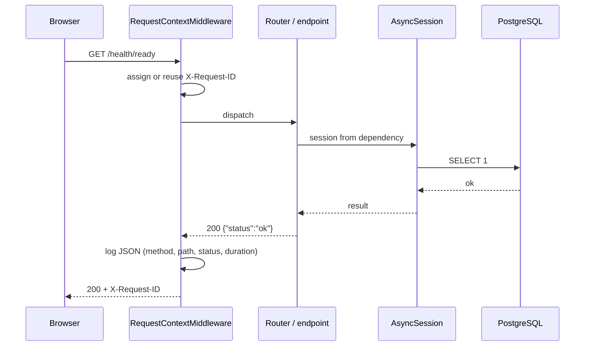
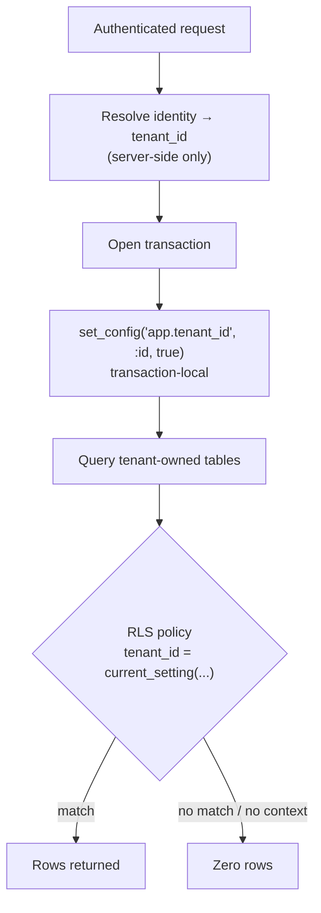
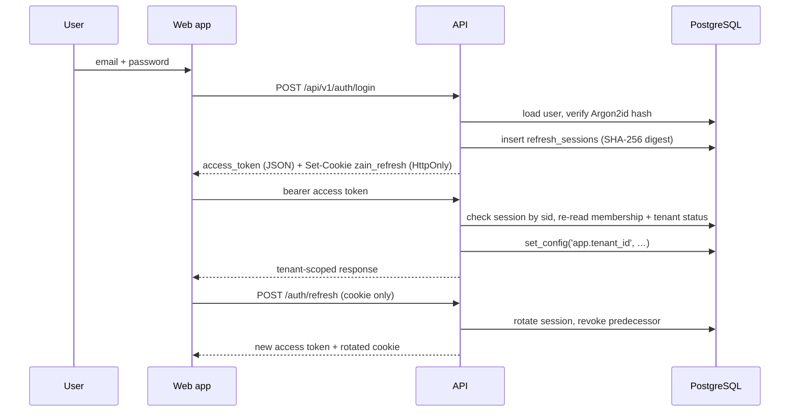

# ZAIN AGRI — System Architecture

Status: Sprint 03
Last updated: 2026-11-01

---

## 1. System context


**Positioning.** The web application is a thin, fast client. All business rules
live in the API. The database is the source of truth, and it also enforces
tenant isolation independently of the application code.

## 2. Container architecture

| Container | Technology | Responsibility |
|---|---|---|
| `apps/web` | Next.js 16 App Router, React 19, Tailwind v4 | Rendering, interaction, RTL/Arabic presentation |
| `apps/api` | FastAPI, Pydantic v2, SQLAlchemy 2 | Business rules, persistence, auth, tenancy |
| PostgreSQL 17 | Local cluster (port 5433) | Data, constraints, RLS policies |
| `docs` | Markdown | Decisions and requirements |

There is deliberately no message broker, no cache layer and no worker process.
Nothing in the implemented sprints needs them, and adding them early would create
operational cost with no user-visible benefit.

## 3. Modular monolith structure

The backend is organised by **business domain**, not by technical layer. A
module owns its models, schemas and routers; cross-module access goes through
explicit functions, not by importing another module's internals.

```mermaid
flowchart TB
    subgraph api["apps/api"]
        main["main.py<br/>app factory · middleware · routers"]
        subgraph core["core/"]
            cfg["config.py<br/>settings"]
            log["logging.py<br/>JSON logs"]
            err["errors.py<br/>error envelope"]
            mw["middleware.py<br/>request id · access log"]
            csrf["csrf.py<br/>origin guard"]
            rl["ratelimit.py<br/>auth throttle"]
        end
        subgraph infra["infrastructure/"]
            db["db/session.py<br/>engine · sessions"]
            base["db/base.py<br/>Base · mixins"]
        end
        subgraph modules["modules/"]
            health["health/<br/>liveness · readiness"]
            identity["identity/<br/>tenant · user · membership"]
            auth["auth/<br/>tokens · sessions · onboarding"]
            authz["authorization/<br/>permission policy"]
            tenants["tenants/<br/>workspace settings · members"]
            tenancy["tenancy/<br/>tenant context"]
            catalog["catalog/<br/>products · categories · brands · units"]
            inventory["inventory/<br/>ledger · balances · batches"]
            audit["audit/<br/>append-only trail"]
            future_mod["sales/ purchases/ customers/ …<br/>(not built)"]
        end
    end

    main --> core
    main --> modules
    main --> infra
    modules --> infra
    modules --> core
```



### Module boundaries

| Module | Owns | May depend on |
|---|---|---|
| `core` | Configuration, logging, errors, middleware, CSRF, rate limiting | nothing |
| `infrastructure` | Engine, sessions, declarative base | `core` |
| `identity` | Tenant, User, Membership models | `core`, `infrastructure` |
| `auth` | Passwords, JWTs, refresh sessions, auth endpoints, tenant onboarding | `core`, `infrastructure`, `identity`, `authorization`, `tenancy` |
| `authorization` | Permission vocabulary and role policy table | `identity` (role enum) |
| `tenants` | Workspace settings, member listing | `auth` dependencies, `authorization`, `identity` |
| `tenancy` | Tenant context propagation | `core`, `infrastructure` |
| `catalog` | Units (read), categories, brands, products, product unit conversions | `identity`, `authorization`, `audit`, `auth` dependencies |
| `inventory` | Stock movements, balances, batches | `catalog`, `authorization`, `audit`, `auth` dependencies |
| `audit` | Append-only audit rows and the owner-only read feed | `authorization`, `auth` dependencies |
| future `sales` | Invoice, line, payment | `catalog`, `inventory`, `identity`, `auth` |
| future `purchases` | Supplier receipt, lines | `catalog`, `inventory`, `identity`, `auth` |

**Rule:** a module never imports another module's ORM models to mutate them.
It calls that module's public functions.

## 4. Request lifecycle



The engine is created lazily on first use. Importing `app.main` opens no sockets,
which keeps tests and CLI tools fast and side-effect free.

## 5. Multi-tenancy strategy



**Layers of defence**

1. **Session-derived tenant.** The tenant id comes from the authenticated
   identity. A `tenant_id` in a request body is ignored.
2. **Row Level Security.** Enabled on all ten tenant-owned tables. Policies
   compare against `current_setting('app.tenant_id')`, which is `NULL` when
   unset — so an unbound query returns zero rows instead of everything. Catalog
   and inventory rows additionally use composite FKs `(tenant_id, parent_id)`, so
   a cross-tenant reference is unrepresentable.
3. **Non-superuser runtime role.** `zain_app` is `NOSUPERUSER NOBYPASSRLS`.
   A superuser would silently ignore every policy, so a test asserts this.
4. **Transaction-local setting.** `set_config(..., true)` is discarded at
   commit, so a pooled connection cannot leak one tenant's context into the
   next request. A session-level `after_begin` hook re-applies the context for
   each later transaction on a bound session.
5. **Schema ownership.** Migrations run as the owner role, the app runs as the
   runtime role. The app cannot alter its own policies.

**Session binding.** An access token's `tid` claim is advisory. The authoritative
binding is `refresh_sessions.tenant_id` for the `sid` in the token, re-validated
against a live, active membership on every request. Switching workspace is a
refresh-token rotation, never a client-supplied header.

**One audited exception.** Before a workspace is chosen there is no RLS context
to read `memberships` with, so login needs to know which workspaces a user may
enter. A narrow `SECURITY DEFINER` function, `app_user_tenants(p_user_id)`,
answers exactly that question, with `search_path` pinned and `EXECUTE` revoked
from `PUBLIC`. It is read-only and returns only that user's rows. See
`docs/security/TENANT_ISOLATION.md` §4.

`users` is intentionally **not** tenant-scoped: one person may belong to several
tenants. Access is mediated by `memberships`. This is documented in
`OPEN_QUESTIONS.md` because it is the least settled part of the identity model.

## 6. Authentication and authorisation

Implemented in Sprint 02. Full detail: `docs/security/AUTHENTICATION.md`,
`docs/security/RBAC.md`, `docs/security/TENANT_ISOLATION.md`.



Choices:

- **JWT access tokens, 15 minutes, HS256**, held in memory by the client. They
  are checked against `refresh_sessions` on every request, so revocation is
  immediate. ADR-008 (opaque sessions only) is superseded by ADR-016.
- **Opaque refresh tokens, rotated on every use**, stored only as SHA-256
  digests, delivered in an `HttpOnly`, `SameSite=Lax`, `Secure` cookie scoped to
  `/api/v1/auth`. Reuse of a rotated token revokes the whole family.
- **Argon2id** password hashing with configurable cost; generic
  `Invalid email or password` for every failure mode.
- **Central permission policy.** Roles are tenant-scoped; endpoints declare a
  permission, never compare roles. The token's `rol` claim is advisory.
- **Tenant selection is server-side.** Multi-workspace users receive
  `requires_tenant_selection: true`, then rotate the refresh token with an
  explicit `tenant_id` that must match an active membership.
- **Onboarding is atomic.** Register → create tenant → `OWNER` membership →
  session re-bound, all in one transaction, with a unique slug.
- **CSRF.** `SameSite=Lax` plus an origin guard on unsafe requests carrying the
  refresh cookie.
- **Rate limiting** on login/register/refresh (in-process; documented limit).

## 7. Database strategy

- One PostgreSQL database, one schema, `tenant_id` on tenant-owned tables.
- UUID primary keys generated in the application (`uuid4`), not by sequences.
- `TIMESTAMPTZ` everywhere, written in UTC.
- Native enums for closed vocabularies (`tenant_status`, `membership_role`,
  `unit_dimension`, `product_status`, `stock_movement_type`).
- Alembic for every schema change; no manual DDL against any environment.
- Database/role split:
  - `zain` — owner, runs migrations.
  - `zain_app` — runtime, subject to RLS.

Full model: `DATABASE_DESIGN.md`.

## 8. Inventory architecture — implemented

Implemented in Sprint 03. Detail: `docs/architecture/INVENTORY_LEDGER.md`,
`docs/modules/INVENTORY.md`.

> Stock is never a mutable number. It is the sum of an immutable ledger.

```
stock_movements (append-only, source of truth)
  tenant_id, product_id, batch_id, movement_type,
  quantity + unit_id (what was entered), base_quantity (signed delta),
  unit_cost, reference_type/reference_id, notes, created_by, created_at
        │
        └──► inventory_balances (projection)
             PK (tenant_id, product_id), quantity NUMERIC(18,4)
```

- **One writer.** Only `inventory/service.py` updates balances; future modules
  call `record_movement` instead of writing the table.
- **One transaction.** The ledger row, the balance update and the audit row
  commit together or not at all.
- **One lock.** `SELECT … FOR UPDATE` on the balance row serialises movements
  per product, which also makes opening-balance and batch-sum checks race-free.
- **Append-only.** A database trigger plus `REVOKE UPDATE/DELETE` means history
  cannot be rewritten by any runtime path. Corrections are compensating
  movements.
- **No valuation yet.** `unit_cost` is recorded, but there is no FIFO, weighted
  average or COGS until `OPEN_QUESTIONS.md` Q27 is answered.

Writable movement types in Sprint 03: `opening_balance`, `adjustment_in`,
`adjustment_out`. The other eight enum values exist for purchasing, sales,
returns, damage, expiry and transfers, which will append their own movements.

## 9. Financial architecture — direction

Not implemented. The intended shape:

- An **invoice** records an obligation; a **payment** records money moving.
  They are never the same row.
- Partial payments are the normal case, not an edge case.
- Unit cost is snapshotted onto the sale line at the moment of sale, so
  changing a supplier price never rewrites history.
- Money is stored as `NUMERIC(14,2)`, never floating point.
- Every mutation carries `created_by` and `created_at`, and an audit row in the
  same transaction — the pattern Sprint 03 established.

## 10. Audit architecture

Implemented in Sprint 03. Detail: `docs/security/AUDIT_LOGGING.md`.

- `audit_logs` is tenant-scoped, append-only, and written in the same
  transaction as the business change through `audit.record()`.
- The service flushes but never commits; a failed audit insert rolls the change
  back, so a mutation cannot exist without its trail.
- Sensitive keys (`password`, `token`, `secret`, `authorization`, `cookie`, …)
  are dropped at any depth before serialisation.
- Reading requires `audit.read` (OWNER-only in the current matrix); there is no
  write endpoint.
- Actor attribution uses `actor_id` with `ON DELETE SET NULL`, so removing a
  user does not erase history.

## 11. AI boundaries

No AI in Sprint 01 or the MVP.

When it arrives, it sits **beside** the API, not inside it:

- The API exposes deterministic, permission-checked read operations.
- AI services consume those operations with a service identity scoped to one tenant.
- No AI component receives raw SQL access or bypasses tenant filters.
- Forecasts are stored as suggestions, never applied automatically to stock.

The prerequisite is trustworthy historical data. Building forecasting on top of
unvalidated inventory would produce confident nonsense.

## 12. Deployment direction

| Environment | Database | Notes |
|---|---|---|
| Local | PostgreSQL 17.5, port 5433 | No Docker required |
| Production (planned) | Managed PostgreSQL 17 | Must match major version |

Production shape (not implemented): containerised API behind a load balancer,
static or server-rendered web app, managed Postgres with point-in-time recovery.
The API is stateless, so it can scale horizontally once sessions live in the
database.

Deployment specifics wait for real requirements — see `OPEN_QUESTIONS.md`.

## 13. Frontend structure

```
apps/web/src
├── app/
│   ├── layout.tsx           html lang=ar dir=rtl, font, AuthProvider
│   ├── (auth)/
│   │   ├── layout.tsx       dark brand canvas, redirect-if-authenticated
│   │   ├── login/page.tsx
│   │   └── register/page.tsx
│   ├── (app)/
│   │   ├── layout.tsx       AuthGuard requireTenant + AppShell
│   │   ├── page.tsx         dashboard
│   │   ├── products/page.tsx    catalog list, filters, dialogs
│   │   ├── inventory/page.tsx   balances, detail panel, adjustments
│   │   └── settings/security/page.tsx
│   ├── select-tenant/page.tsx
│   ├── loading.tsx, error.tsx, not-found.tsx
│   └── globals.css          design tokens (@theme)
├── components/
│   ├── auth/auth-guard.tsx  client-side navigation guard
│   ├── shell/               sidebar, header, app shell
│   ├── dashboard/           stat card
│   ├── catalog/             product dialog, taxonomy dialog
│   ├── inventory/           adjustment dialog, batch dialog
│   └── ui/                  card, badge, field, modal
└── lib/
    ├── api.ts               in-memory access token, silent refresh
    ├── auth-provider.tsx    session state and auth actions
    ├── catalog.ts           Arabic labels, formatters, unit conversion
    ├── types.ts             API contracts + Arabic labels
    └── utils.ts             cn()
```

**Token handling in the browser.** The access token lives in a module-level
variable. The refresh token is an `HttpOnly` cookie the client cannot read; on a
`401` the API client rotates it once (deduplicated across concurrent requests)
and replays the request. No token is ever written to `localStorage`,
`sessionStorage`, IndexedDB or a readable cookie.

**Route protection is a UX layer.** `AuthGuard` prevents flashing data and sends
unauthenticated visitors to `/login`. Every request is authorised again by the
API, which derives the workspace from the session — not from the URL.

**Design tokens live in CSS, not in a JS config.** Tailwind v4 reads `@theme`,
so the palette is one source of truth (`--color-brand-*`, `--color-accent-*`,
`--color-surface`, `--color-ink`, `--color-line`).

**RTL is structural, not a stylesheet swap.** The document is `dir="rtl"` and
layout uses logical properties (`ms-*`, `me-*`, `ps-*`, `pe-*`), so the same
components work in both directions without a second theme.

## 14. Known architectural risks

| Risk | Impact | Mitigation |
|---|---|---|
| `users` is global, not tenant-scoped | A bug could expose user records across tenants | All user access is mediated by a membership check; listed in `TENANT_ISOLATION.md` |
| `app_user_tenants` is executable by the runtime role for any user id | SQL injection could enumerate memberships | Parameter binding everywhere; function is read-only, `search_path` pinned, `PUBLIC` revoked |
| Tenant context must be set per transaction | A missed call fails closed (no rows) rather than leaking | Fail-closed policies + `after_begin` re-apply + isolation tests |
| Access-token validation hits the database on every request | A hot-path lookup | One indexed PK read; intentional to keep revocation immediate |
| Rate limiting is per worker | A distributed brute force gets N × the limit | Documented; shared store is a production requirement |
| No cost/valuation method | Stock value and margins cannot be reported | `unit_cost` is captured now; the method waits for Q27 |
| Audit volume is unbounded | `audit_logs` grows with every mutation | Retention and partitioning are launch tasks |
| Ledger reconciliation is not scheduled | A projection drift would go unnoticed in production | Run the reconciliation query as a periodic integrity job before launch |
| Future tenant tables may ship without RLS | A new table silently escapes the boundary | Review rule: every `tenant_id` table ships with policies in the same migration |
| No email delivery | Password reset and verification are unavailable | `REQUIRE_EMAIL_VERIFICATION=false`; production requirement documented |
| Windows dev requires selector event loop | Confusing "works on Linux" failures | Encoded in `run.py` and documented |
