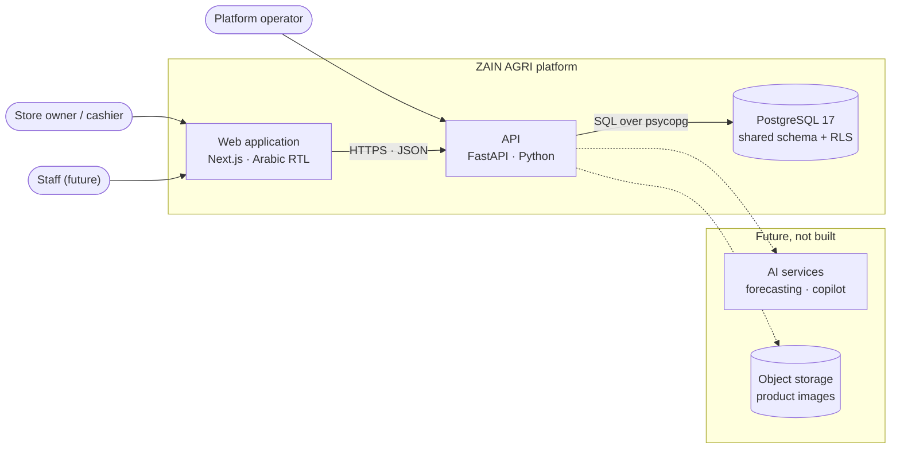
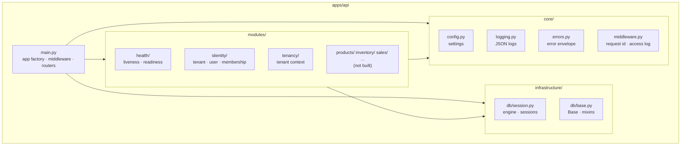
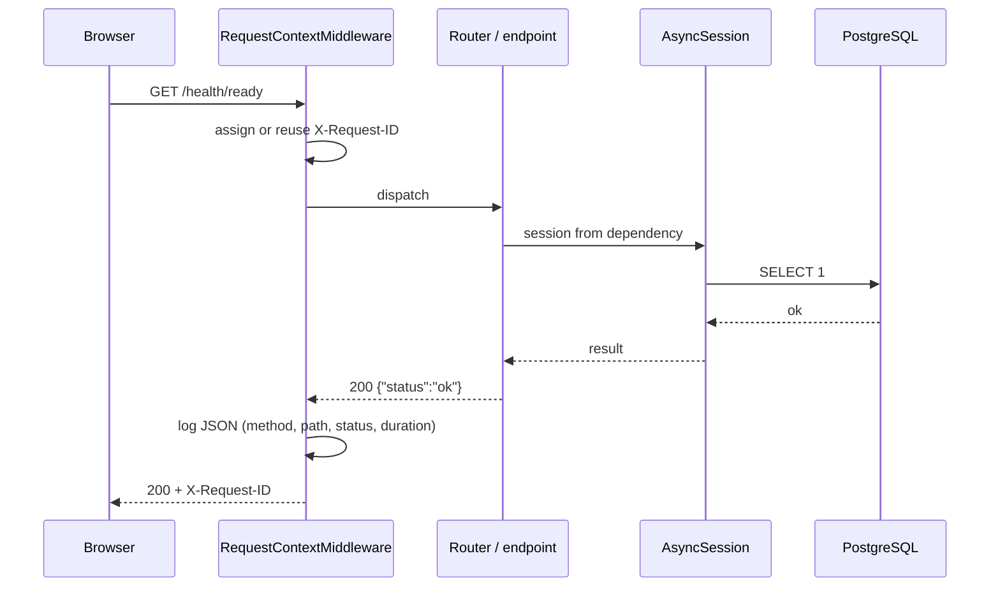
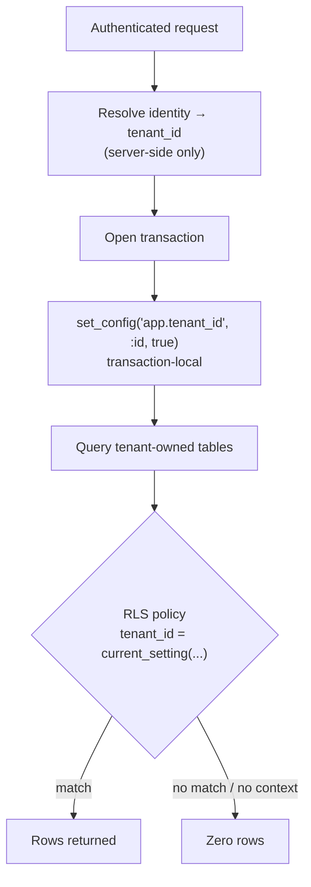
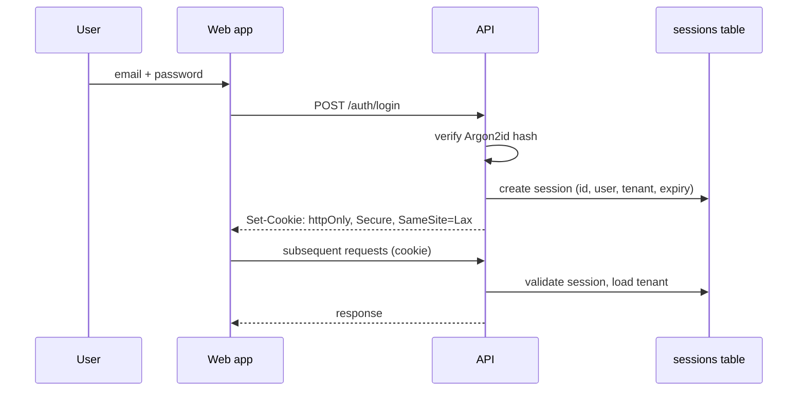

# ZAIN AGRI — System Architecture

Status: Sprint 01
Last updated: 2026-10-30

---

## 1. System context



**Positioning.** The web application is a thin, fast client. All business rules
live in the API. The database is the source of truth, and it also enforces
tenant isolation independently of the application code.

## 2. Container architecture

| Container | Technology | Responsibility |
|---|---|---|
| `apps/web` | Next.js 16 App Router, React 19, Tailwind v4 | Rendering, interaction, RTL/Arabic presentation |
| `apps/api` | FastAPI, Pydantic v2, SQLAlchemy 2 | Business rules, persistence, auth, tenancy |
| PostgreSQL 17 | Local cluster (port 5433) | Data, constraints, RLS policies |
| `docs` | Markdown | Decisions and requirements |

There is deliberately no message broker, no cache layer and no worker process.
Nothing in Sprint 01 needs them, and adding them early would create operational
cost with no user-visible benefit.

## 3. Modular monolith structure

The backend is organised by **business domain**, not by technical layer. A
module owns its models, schemas and routers; cross-module access goes through
explicit functions, not by importing another module's internals.



### Module boundaries

| Module | Owns | May depend on |
|---|---|---|
| `core` | Configuration, logging, errors, middleware | nothing |
| `infrastructure` | Engine, sessions, declarative base | `core` |
| `identity` | Tenant, User, Membership | `core`, `infrastructure` |
| `tenancy` | Tenant context propagation | `core`, `infrastructure` |
| future `products` | Product, Category, Unit | `identity` (tenant id) |
| future `inventory` | Movement ledger, batches | `products`, `identity` |
| future `sales` | Invoice, line, payment | `products`, `inventory`, `identity` |

**Rule:** a module never imports another module's ORM models to mutate them.
It calls that module's public functions.

## 4. Request lifecycle



The engine is created lazily on first use. Importing `app.main` opens no sockets,
which keeps tests and CLI tools fast and side-effect free.

## 5. Multi-tenancy strategy



**Layers of defence**

1. **Session-derived tenant.** The tenant id comes from the authenticated
   identity. A `tenant_id` in a request body is ignored.
2. **Row Level Security.** Enabled on `tenants` and `memberships`. Policies
   compare against `current_setting('app.tenant_id')`, which is `NULL` when
   unset — so an unbound query returns zero rows instead of everything.
3. **Non-superuser runtime role.** `zain_app` is `NOSUPERUSER NOBYPASSRLS`.
   A superuser would silently ignore every policy, so a test asserts this.
4. **Transaction-local setting.** `set_config(..., true)` is discarded at
   commit, so a pooled connection cannot leak one tenant's context into the
   next request.
5. **Schema ownership.** Migrations run as the owner role, the app runs as the
   runtime role. The app cannot alter its own policies.

`users` is intentionally **not** tenant-scoped: one person may belong to several
tenants. Access is mediated by `memberships`. This is documented in
`OPEN_QUESTIONS.md` because it is the least settled part of the identity model.

## 6. Authentication and authorisation — direction

Not implemented in Sprint 01. The intended shape:



Choices already made:

- Opaque server-side sessions, not JWTs — revocation must be immediate for a
  point-of-sale system.
- `httpOnly` cookies, never `localStorage` — no token readable by JavaScript.
- Argon2id password hashing.

Open: whether one user can switch tenants within a session, and how the first
tenant user is provisioned. Both are in `OPEN_QUESTIONS.md`.

## 7. Database strategy

- One PostgreSQL database, one schema, `tenant_id` on tenant-owned tables.
- UUID primary keys generated in the application (`uuid4`), not by sequences.
- `TIMESTAMPTZ` everywhere, written in UTC.
- Native enums for closed vocabularies (`tenant_status`, `membership_role`).
- Alembic for every schema change; no manual DDL against any environment.
- Database/role split:
  - `zain` — owner, runs migrations.
  - `zain_app` — runtime, subject to RLS.

Full model: `DATABASE_DESIGN.md`.

## 8. Inventory architecture — direction

Not implemented. The intended invariant:

> Stock is never a mutable number. It is the sum of an immutable ledger.

```
stock_movements (append-only)
  tenant_id, product_id, batch_id, quantity_delta, reason, reference, occurred_at
```

Balances are derived, and cached only as a materialised projection if
measurement proves it necessary. Corrections are new movements, never updates.
This is what makes "why is stock 3?" answerable two years later.

## 9. Financial architecture — direction

Not implemented. The intended shape:

- An **invoice** records an obligation; a **payment** records money moving.
  They are never the same row.
- Partial payments are the normal case, not an edge case.
- Unit cost is snapshotted onto the sale line at the moment of sale, so
  changing a supplier price never rewrites history.
- Money is stored as `NUMERIC(14,2)`, never floating point.
- Every mutation carries `created_by` and `created_at`.

## 10. AI boundaries

No AI in Sprint 01 or the MVP.

When it arrives, it sits **beside** the API, not inside it:

- The API exposes deterministic, permission-checked read operations.
- AI services consume those operations with a service identity scoped to one tenant.
- No AI component receives raw SQL access or bypasses tenant filters.
- Forecasts are stored as suggestions, never applied automatically to stock.

The prerequisite is trustworthy historical data. Building forecasting on top of
unvalidated inventory would produce confident nonsense.

## 11. Deployment direction

| Environment | Database | Notes |
|---|---|---|
| Local | PostgreSQL 17.5, port 5433 | No Docker required |
| Production (planned) | Managed PostgreSQL 17 | Must match major version |

Production shape (not implemented): containerised API behind a load balancer,
static or server-rendered web app, managed Postgres with point-in-time recovery.
The API is stateless, so it can scale horizontally once sessions live in the
database.

Deployment specifics wait for real requirements — see `OPEN_QUESTIONS.md`.

## 12. Frontend structure

```
apps/web/src
├── app/
│   ├── layout.tsx      html lang=ar dir=rtl, font, shell
│   ├── page.tsx        dashboard
│   ├── loading.tsx     skeleton
│   ├── error.tsx       recoverable error state
│   ├── not-found.tsx   404
│   └── globals.css     design tokens (@theme)
├── components/
│   ├── brand.tsx       mark + wordmark
│   ├── shell/          sidebar, header
│   ├── dashboard/      stat card
│   └── ui/             card, badge
└── lib/utils.ts        cn()
```

**Design tokens live in CSS, not in a JS config.** Tailwind v4 reads `@theme`,
so the palette is one source of truth (`--color-brand-*`, `--color-accent-*`,
`--color-surface`, `--color-ink`, `--color-line`).

**RTL is structural, not a stylesheet swap.** The document is `dir="rtl"` and
layout uses logical properties (`ms-*`, `me-*`, `ps-*`, `pe-*`), so the same
components work in both directions without a second theme.

## 13. Known architectural risks

| Risk | Impact | Mitigation |
|---|---|---|
| `users` is global, not tenant-scoped | A bug could expose user records across tenants | Mediate all access through membership checks; revisit in Sprint 02 |
| Tenant context must be set per transaction | A missed call fails closed (no rows) rather than leaking | Fail-closed policies + isolation tests in CI |
| Enums are provisional | Role vocabulary may change | New migration; enums are cheap to extend |
| No audit log yet | Mutations are unattributable | Audit table scheduled with sales/finance |
| Windows dev requires selector event loop | Confusing "works on Linux" failures | Encoded in `run.py` and documented |
