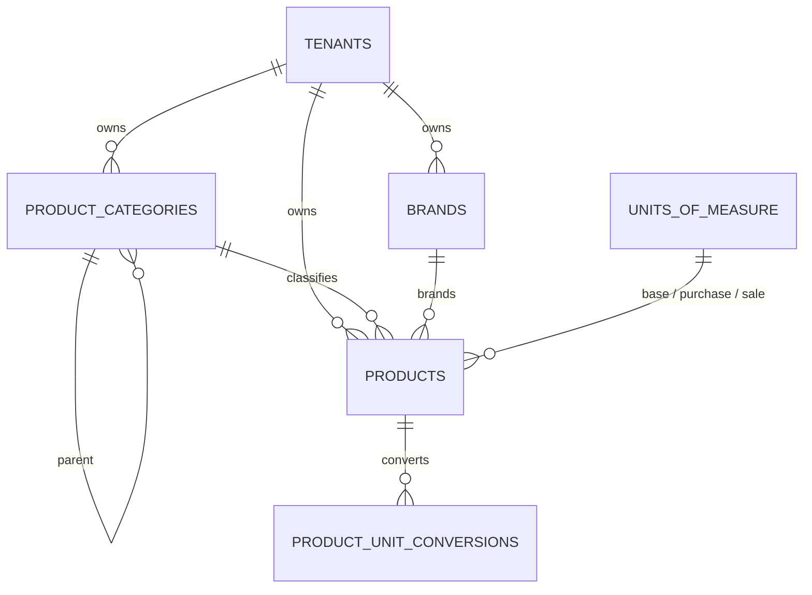

# ZAIN AGRI — Product Catalog

Status: Sprint 03
Last updated: 2026-11-01
Code: `apps/api/app/modules/catalog/`, `apps/web/src/app/(app)/products/`

The catalog is deliberately small: what a product *is* (name, SKU, barcode,
category, brand, base unit, price, batch tracking). Agricultural attributes
(active ingredient, N-P-K, dose, pre-harvest interval) are **not** modelled yet —
see `open questions` in `docs/architecture/OPEN_QUESTIONS.md` §B.

---

## 1. Data model

| Table | Tenant-owned | Notes |
|---|---|---|
| `units_of_measure` | **no** — global | Seeded by migration `0004_catalog`, read-only at runtime |
| `product_categories` | yes | Self-referencing hierarchy, unique name per parent |
| `brands` | yes | Unique name per tenant |
| `products` | yes | SKU unique per tenant; barcode unique per tenant when present |
| `product_unit_conversions` | yes | Explicit pair, at least one side is the base unit |

### 1.1 Units of measure

Nine units are seeded and cannot be written by the runtime role (`grants.sql`
revokes `INSERT/UPDATE/DELETE` on `units_of_measure`):

| Dimension | Codes |
|---|---|
| `count` | `piece`, `pack`, `box`, `bag`, `bottle` |
| `mass` | `kilogram`, `gram` |
| `volume` | `liter`, `milliliter` |

A unit is global because every store sells kilograms, and a per-tenant copy
would only produce divergent ids for the same physical unit.

### 1.2 Product rules

| Rule | Enforcement |
|---|---|
| `name_ar` required, `name` optional | `ProductCreate` + column nullability |
| `sku` unique per tenant | `uq_products_tenant_sku` |
| `barcode` unique per tenant, nullable | Partial unique index `uq_products_tenant_barcode` |
| Money `NUMERIC(14,2)`, quantities `NUMERIC(18,4)` | Columns; serialised as decimal strings |
| `status` ∈ `active`, `archived` | `product_status` enum |
| Archive instead of delete | `DELETE /products/{id}` sets `archived` |
| Archived products are frozen | Updates, movements and new batches are rejected (409) |
| Base unit frozen once conversions or movements exist | Checked in the service before update |
| Disabling batch tracking blocked while batches exist | Checked in the service |

### 1.3 Conversions

A conversion is a row `(product, from_unit, to_unit, factor)` where
`1 from_unit = factor to_unit`. It is **product-specific** and must involve the
product's base unit, so the ledger never needs to chain two conversions.

- Both units must exist and share a dimension (`count`/`mass`/`volume`).
- Duplicate pairs are rejected (409), including the reversed pair.
- Changing the base unit after a conversion exists is rejected (409).

This is a deliberate limit: a chain such as *bag → kilogram → gram* is
ambiguous in the real world (how many kilograms is *this* bag?) and guessing it
would corrupt stock.

## 2. API

All routes are under `/api/v1`. Every handler requires a permission; none reads
a `tenant_id` from the request.

| Method | Path | Permission |
|---|---|---|
| GET | `/units` | `products.read` |
| GET | `/categories` | `products.read` |
| POST | `/categories` | `categories.manage` |
| PATCH | `/categories/{id}` | `categories.manage` |
| GET | `/brands` | `products.read` |
| POST | `/brands` | `categories.manage` |
| GET | `/products` | `products.read` |
| POST | `/products` | `products.create` |
| GET | `/products/{id}` | `products.read` |
| PATCH | `/products/{id}` | `products.update` |
| DELETE | `/products/{id}` | `products.archive` |
| POST | `/products/{id}/restore` | `products.archive` |
| POST | `/products/{id}/conversions` | `products.update` |

`GET /products` accepts `q` (name, SKU, barcode), `status`, `category_id`,
`page`, `page_size`. The response includes `stock_quantity` and `stock_status`
(`out`/`low`/`ok`) joined from `inventory_balances`, so the catalog list does not
make one request per row.

### 2.1 Cost visibility

`cost_price` is serialised as `null` unless the caller holds
`inventory.view_cost` (OWNER only in the Sprint 03 matrix). Writing a cost
without that permission returns `403` with
`details.permission = "inventory.view_cost"`.

This is a **view** of the same row, not a second table: there is no separate
cost column to leak through a projection or an export.

### 2.2 Errors

| Situation | Status | `error.code` |
|---|---|---|
| Unknown category/brand/unit, cross-tenant reference | 422 | `unprocessable` |
| Wrong unit dimension, conversion not touching base unit | 422 | `unprocessable` |
| Duplicate SKU / barcode / brand / category sibling | 409 | `conflict` |
| Category cycle or self-parent | 409 | `conflict` |
| Update/archive on an archived product | 409 | `conflict` |
| Missing permission | 403 | `forbidden` |
| Another tenant's row | 404 | `not_found` |

## 3. Frontend

`/products` is a single client page:

- Search box (submits on Enter / بحث), status filter, category filter, pagination.
- Table: name + SKU/barcode, category, base unit, stock with a status badge,
  sale price, cost (only for `inventory.view_cost`), status, actions.
- Actions are permission-gated (`products.create`, `products.update`,
  `products.archive`) — the server re-checks every call.
- `ProductDialog` creates and edits a product, and manages conversions for an
  existing product. The base-unit select is disabled once a conversion exists.
- `TaxonomyDialog` creates categories (with an optional parent) and brands.
- Loading, empty (no rows vs. no matches), and error states are explicit; no
  placeholder or demo products are rendered.

## 4. Tests

| Suite | Covers |
|---|---|
| `tests/test_products.py` | Seeded units, product creation, cost visibility, SKU/barcode uniqueness, cross-tenant category, unknown unit, archive/restore, search/filter/pagination, stock status, category guardrails, conversions, base-unit freeze, tenant scoping |
| `tests/test_catalog_isolation.py` | RLS on all eight Sprint 03 tenant tables, including this module's four |
| `tests/test_audit.py` | `product.created/updated/archived`, `category.*`, `brand.*` audit rows |

## 5. Deliberate gaps

- No product images or attachments (no object storage yet).
- No category/brand delete endpoints: categories are referenced by products, and
  deleting a brand would silently reclassify history.
- No bulk edit or import: the workbook format is unknown (`OPEN_QUESTIONS.md`
  Q24), so no importer is invented.
- No agronomic attribute tables until the required fields are confirmed (Q8).
