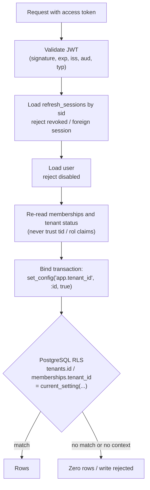

# ZAIN AGRI — Tenant Isolation

Status: Sprint 02
Last updated: 2026-10-31

Tenant isolation is the property that a request authenticated as a member of
workspace A can never read, create, update or delete anything belonging to
workspace B — even if the application code contains a bug. This document
describes the controls, the one deliberate exception, and the tests that prove
the claim.

> **Rule:** isolation is not claimed unless a test fails when the protection is
> removed. The suites referenced here run against the real runtime role, the
> real migrations and a real PostgreSQL pool.

---

## 1. Layers of defence



| Layer | What it enforces |
|---|---|
| 1. Token validation | The caller is a live session belonging to a real, active user |
| 2. Server-side tenant resolution | Workspace comes from the session row, not from the request |
| 3. Membership & tenant status | Access is re-checked on every request; revocations are immediate |
| 4. Application predicates | Queries also filter by `tenant_id` explicitly |
| 5. PostgreSQL RLS | The database refuses cross-tenant rows independently |
| 6. Non-superuser role | `zain_app` is `NOSUPERUSER NOBYPASSRLS` and does not own the tables |
| 7. Transaction-local context | The setting dies at commit, so pooled connections cannot leak it |

Layers 4 and 5 are intentionally redundant. Layer 4 gives readable queries and
useful indexes; layer 5 is the one that still holds when layer 4 is forgotten.

## 2. Where the tenant id comes from

```
access token.tid  ──►  refresh_sessions.tenant_id  ──►  membership lookup  ──►  RLS context
        (advisory)          (the real binding)          (live validation)
```

- `tid` is written when the token is minted and is **never trusted on its own**.
- The authoritative binding is `refresh_sessions.tenant_id` for the `sid` in the
  token. Revoking that session (or deleting the workspace) removes access.
- `get_current_tenant()` calls `app_user_tenants(user_id)`, confirms the
  membership exists, that `membership_status = 'active'` and that
  `tenant_status = 'active'`, then binds the transaction.
- A `tenant_id` in a JSON body, query string or header is not read anywhere.
  `PATCH /tenants/current` ignores an extra `tenant_id` field, and a test proves
  that passing another workspace's id changes nothing.

Errors are deliberately specific but non-enumerating:

| Situation | Response |
|---|---|
| No workspace bound to the session | `403 No workspace selected for this session` |
| Workspace not among the caller's memberships | `403 You do not have access to this workspace` |
| Membership suspended/invited | `403 Your access to this workspace is not active` |
| Tenant suspended | `403 This workspace is suspended` |
| Session revoked / tenant deleted | `401 Invalid or expired access token` |

## 3. Row Level Security

Enabled on the two tenant-owned tables that exist today.

```sql
-- tenants: the row's own id is its tenancy scope
ALTER TABLE tenants ENABLE ROW LEVEL SECURITY;
CREATE POLICY tenants_tenant_isolation ON tenants
    USING      (id = nullif(current_setting('app.tenant_id', true), '')::uuid)
    WITH CHECK (id = nullif(current_setting('app.tenant_id', true), '')::uuid);

-- memberships: scoped by the tenant the row belongs to
ALTER TABLE memberships ENABLE ROW LEVEL SECURITY;
CREATE POLICY memberships_tenant_isolation ON memberships
    USING      (tenant_id = nullif(current_setting('app.tenant_id', true), '')::uuid)
    WITH CHECK (tenant_id = nullif(current_setting('app.tenant_id', true), '')::uuid);
```

Why each detail matters:

- **`current_setting(..., true)`** returns `NULL` when the setting is absent, and
  any comparison with `NULL` is unknown, so the policy rejects every row. An
  unbound query returns nothing rather than everything.
- **`nullif(..., '')`** makes an explicit clear (`set_config(..., '')`) behave
  like "no context" instead of raising a cast error.
- **`WITH CHECK`** covers inserts and updates. A transaction bound to tenant A
  cannot insert a membership for tenant B; PostgreSQL raises
  `new row violates row-level security policy`.

### 3.1 Transaction scoping and pool reuse

`set_config('app.tenant_id', :id, true)` is transaction-local. A commit or
rollback discards it. An `after_begin` SQLAlchemy listener re-applies the
session's bound tenant at the start of every later transaction, because without
it the first query after `commit()` would silently run with no context.

The re-apply hook only fires for a session that was explicitly bound via
`set_tenant_context()`. A fresh session from the pool has no entry in
`session.info`, so it starts unbound and fails closed.

Tests cover this directly:

| Test | Proves |
|---|---|
| `test_set_config_is_transaction_local` | `current_setting` is empty after `COMMIT` on the same connection |
| `test_pooled_connection_does_not_leak_tenant_context` | `pool_size=1`; a second session is handed the same backend pid and sees no rows |
| `test_clearing_the_context_fails_closed` | Explicit clear returns zero rows |
| `test_no_tenant_context_returns_no_rows` | An unbound runtime session sees nothing |
| `test_invalid_tenant_context_returns_no_rows` | A random UUID behaves like no context |

### 3.2 Why `users` and `refresh_sessions` are not under RLS

- `users` is global by design (one person may serve several stores). Access is
  mediated by membership checks, and user rows are only returned through
  endpoints that first resolve a tenant context.
- `refresh_sessions` is the session itself: rotation happens before a workspace
  is known (a user may not have created one yet). Every query filters by
  `user_id`, and the row is never exposed by the API. Deleting a tenant cascades
  its sessions away, which immediately invalidates the matching access tokens.

Both are documented residual risks, not oversights.

## 4. The one audited exception: `app_user_tenants`

Login and tenant selection must answer "which workspaces does this user belong
to?" while `tenants` and `memberships` are behind RLS. The alternatives were:

1. Add a permissive policy branch (`user_id = ...`) — weakens every query.
2. Query as the owner role — puts a superuser path in the runtime.
3. One narrow `SECURITY DEFINER` function — chosen.

```sql
CREATE FUNCTION app_user_tenants(p_user_id uuid)
RETURNS TABLE (tenant_id uuid, tenant_name text, tenant_slug text,
               tenant_status tenant_status, role membership_role,
               membership_status membership_status)
LANGUAGE sql STABLE SECURITY DEFINER
SET search_path = public, pg_temp
AS $$
    SELECT t.id, t.name, t.slug, t.status, m.role, m.status
    FROM memberships m JOIN tenants t ON t.id = m.tenant_id
    WHERE m.user_id = p_user_id
    ORDER BY t.name
$$;

REVOKE ALL ON FUNCTION app_user_tenants(uuid) FROM PUBLIC;
GRANT EXECUTE ON FUNCTION app_user_tenants(uuid) TO zain_app;
```

Hardening:

- `SECURITY DEFINER` with a pinned `search_path` prevents object-shadowing.
- `STABLE` (read-only) and `LANGUAGE sql` mean no dynamic SQL.
- `PUBLIC` execute is revoked; only the runtime role may call it. A test asserts
  the ACL and that the owner is not `zain_app`.
- The function is **read-only** and returns only rows for the id it was given.
  It does not create a write path and cannot bypass `WITH CHECK` policies.

**Residual risk.** Any SQL injection in the application could call this function
with someone else's user id and enumerate their workspace names. That risk is
accepted because the app uses SQLAlchemy parameter binding throughout, and the
alternative designs are worse. It is repeated in §7.

## 5. Onboarding under RLS

Creating the first workspace is the awkward case: the row does not exist yet, so
there is no context to bind. The chosen approach keeps the policy strict.

1. Generate the tenant UUID in the application.
2. `set_tenant_context(session, new_id)` **before** the insert.
3. Insert the tenant with that exact id and an `OWNER` membership.
4. Rotate the refresh session onto the new tenant in the same transaction.
5. Commit.

Because `tenants` uses `WITH CHECK (id = current_setting(...))`, the insert only
succeeds for the id that was just bound. There is no "anyone may insert a
tenant" escape hatch, and a client-supplied id is never used. Slug collisions
retry with a random suffix after rolling back.

## 6. Test results

All suites run against `zain_agri_test` with the runtime role, after applying
migrations `0001`–`0003` and `grants.sql`.

| Suite | Tests | Result |
|---|---|---|
| `tests/test_tenant_isolation.py` | RLS at the SQL layer, pool reuse, function ACL | pass |
| `tests/test_tenant_isolation_api.py` | Cross-tenant HTTP access, interleaved requests, deleted workspace | pass |
| `tests/test_auth_flow.py` | Login/refresh/revocation/onboarding/CSRF | pass |
| `tests/test_rbac.py` | Role matrix and live re-authorisation | pass |
| `tests/test_health.py` | Liveness/readiness | pass |
| **Total** | **85** | **85 passed** |

Coverage of the brief's required cases:

- Missing tenant context → `test_no_tenant_context_returns_no_rows`
- Invalid tenant context → `test_invalid_tenant_context_returns_no_rows`
- Cross-tenant SELECT → `test_tenant_sees_only_its_own_rows`, `test_memberships_are_isolated`, plus the API equivalents
- Cross-tenant INSERT → `test_cannot_insert_into_another_tenant`
- Cross-tenant UPDATE → `test_cross_tenant_update_is_a_no_op`
- Cross-tenant DELETE → `test_cross_tenant_delete_is_a_no_op`
- Pool reuse → `test_pooled_connection_does_not_leak_tenant_context`
- Rollback/cleanup → `test_set_config_is_transaction_local`, `test_clearing_the_context_fails_closed`
- Runtime role cannot bypass RLS → `test_runtime_role_cannot_bypass_rls`

A group of tests deliberately asserts the *negative* direction: renaming a
workspace cannot touch another, passing a foreign `tenant_id` in the body is
ignored, and a role held in one workspace grants nothing in another.

## 7. Limitations and follow-ups

1. **Only current tenant-owned tables are protected.** `tenants` and
   `memberships` have policies. Every future table (`products`, `invoices`, …)
   must ship with `ENABLE ROW LEVEL SECURITY` and both `USING` and `WITH CHECK`
   clauses in the same migration. Add a CI check that fails when a table has a
   `tenant_id` column but no policy.
2. **`app_user_tenants` is callable by the runtime role for any user id.** See
   §4. Mitigation: no dynamic SQL, no string interpolation anywhere in the app.
3. **`users` is not RLS-protected.** A missing membership check in a future
   endpoint could expose user records. Code review must treat `User` queries as
   sensitive; consider a `SECURITY DEFINER` projection for staff lists later.
4. **Connection poolers that reuse server-side sessions** (e.g. PgBouncer in
   `session` pooling mode) still rely on transaction-local settings; this design
   is compatible, but the re-apply hook assumes SQLAlchemy owns the transaction.
   Verify before introducing an external pooler.
5. **No audit trail for cross-tenant attempts.** Rejections are logged with
   request id, path and status, not with the attempted tenant id (which would be
   attacker-controlled). A security audit table is a Sprint 03 candidate.
6. **RLS is not a substitute for backups and encryption.** A database
   superuser, a backup, or a physical disk can still read everything.
